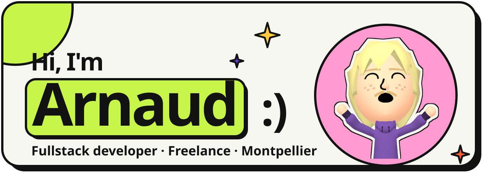
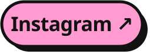
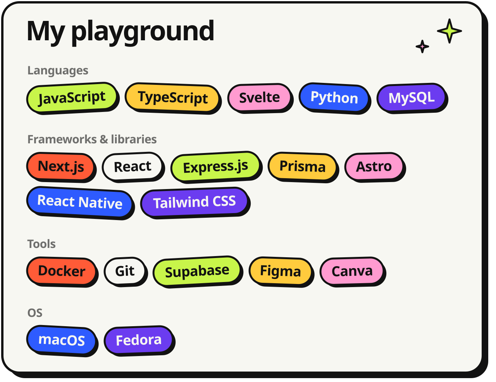

  <picture><source media="(prefers-color-scheme: dark)" srcset="assets/header-dark.svg"></picture>

 

I'm a freelance Fullstack Developer and Master's student at EPSI. I mainly work with JS to build web applications, from internal tools to user interfaces. Outside of work, I enjoy building side projects to keep learning and improving my skills.

  <a href="https://www.arnaudroyer.fr"><picture><source media="(prefers-color-scheme: dark)" srcset="assets/btn-portfolio-dark.svg"></picture></a>
  <a href="mailto:contact@arnaudroyer.fr"><picture><source media="(prefers-color-scheme: dark)" srcset="assets/btn-email-dark.svg"></picture></a>
  <a href="https://linkedin.com/in/royer-arnaud"><picture><source media="(prefers-color-scheme: dark)" srcset="assets/btn-linkedin-dark.svg"></picture></a>
  <a href="https://instagram.com/itsarnaud.dev"><picture><source media="(prefers-color-scheme: dark)" srcset="assets/btn-instagram-dark.svg"></picture></a>

 

  

 

  <picture><source media="(prefers-color-scheme: dark)" srcset="assets/stack-dark.svg"></picture>

 

<picture>
  
</picture>
